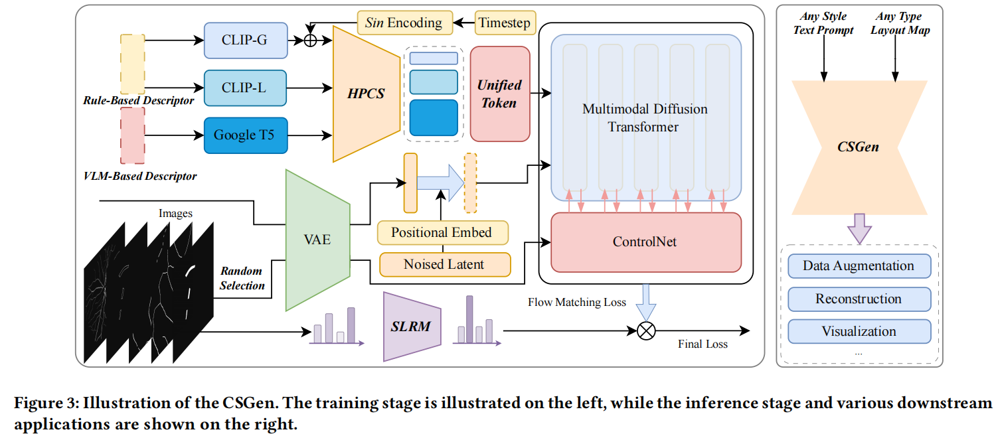
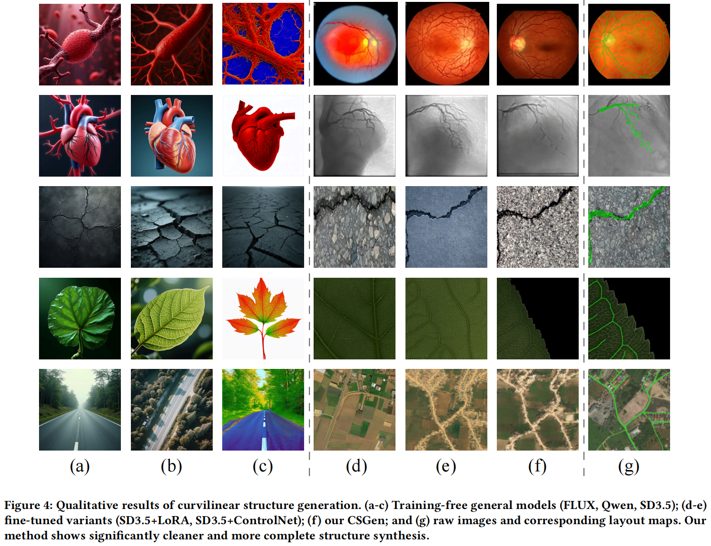

# CSGen

<div align="center">

## CSGen: A Multi-Domain Curvilinear Structure Generation Model via Hierarchical Multimodal Diffusion

**ACM Multimedia 2026**

[](https://arxiv.org/abs/2608.04655)
[](https://doi.org/10.1145/3767308.3835990)
[](https://huggingface.co/datasets/Imoooooo/CSGen)

</div>

CSGen is a unified diffusion framework for **controllable curvilinear structure generation** across multiple domains, including retinal blood vessels, coronary arteries, concrete cracks, leaf veins, and road networks.

Built upon Stable Diffusion 3.5, CSGen combines flexible structural conditioning, hierarchical multimodal text guidance, and sparsity-aware optimization to improve structural alignment, topological connectivity, and visual fidelity.

---

## Overview

<p align="center">
  
</p>

<p align="center">

</p>

CSGen introduces two key components:

- **Hierarchical Progressive Control Strategy (HPCS):** decouples geometric semantics from detailed visual context and progressively introduces contextual information during training.
- **Sparsity-Aware Loss Re-weighting Mechanism (SLRM):** emphasizes thin and fragile structures during optimization to improve fine-grained topology preservation.

The framework supports multiple structural conditions:

`Mask` · `Width Map` · `Sketch` · `Edge` · `Partial Sketch`

---

## Qualitative Results

<p align="center">
  
</p>

<p align="center">

</p>

The comparison includes training-free models such as **FLUX, Qwen, and SD3.5**, fine-tuned variants including **SD3.5 + LoRA** and **SD3.5 + ControlNet**, and our **CSGen**. The generated results show that CSGen better preserves fine branches and structural connectivity. 

---

## Dataset

The processed CSGen dataset is publicly available on Hugging Face:

### 🤗 [Imoooooo/CSGen](https://huggingface.co/datasets/Imoooooo/CSGen)

The dataset covers five representative curvilinear domains and provides image-mask pairs, multiple structural control maps, and hierarchical text descriptions used for controllable generation.

Each processed sample follows the structure:

```text
sample_xxxxxx/
├── image.png
├── mask.png
├── width_map.png
├── sketch.png
├── edge.png
├── partial_sketch.png
└── sample_xxxxxx.json
```

---

## Installation

Clone the repository:

```bash
git clone https://github.com/ShanZard/CSGen.git
cd CSGen
```

Install the package:

```bash
python -m pip install -e .
```

Python 3.10+ and a CUDA-compatible PyTorch environment are recommended.

Stable Diffusion 3.5 Medium should be available locally or through an authorized Hugging Face account.

---

## Training

Set the model, dataset, and output paths:

```bash
export BASE_MODEL=/path/to/stable-diffusion-3.5-medium
export TRAIN_DATA_DIR=/path/to/processed_data
export OUTPUT_DIR=/path/to/csgen_output
```

Start training:

```bash
bash examples/controlnet/run_train.sh
```

The SD3.5 backbone, VAE, and text encoders remain frozen during training, while the structural control branch and HPCS modules are optimized.

---

## Inference

Prepare a structural condition and text prompts:

```bash
export BASE_MODEL=/path/to/stable-diffusion-3.5-medium
export TRAINED_MODEL_DIR=/path/to/csgen_output

export CONTROL_IMAGE=/path/to/control.png
export DOMAIN=road_network

export RULE_PROMPT="road network, narrow, curved, branching, continuous"
export VLM_PROMPT="a remote-sensing image with natural terrain texture and clear road structures"

export OUTPUT_IMAGE=/path/to/generated.png
```

Generate an image:

```bash
bash examples/controlnet/run_generate.sh
```

You can use different structural inputs such as masks, edges, sketches, partial sketches, or width maps.

---

## Project Structure

```text
CSGen/
├── examples/
│   └── controlnet/
│       ├── train.py
│       ├── generate.py
│       ├── run_train.sh
│       └── run_generate.sh
├── src/
│   └── csgen/
│       ├── models/
│       │   └── hpcs.py
│       └── utils/
│           ├── flow.py
│           ├── prompts.py
│           ├── slrm.py
│           └── text_encoding.py
├── requirements.txt
└── pyproject.toml
```

---

## Citation

If you find CSGen useful for your research, please cite:

```bibtex
@inproceedings{shan2026csgen,
  title     = {CSGen: A Multi-Domain Curvilinear Structure Generation Model via Hierarchical Multimodal Diffusion},
  author    = {Shan, Zhe and Yang, Ziming and Zhou, Lei and Zhang, Wenwen and Lin, Cong and Xie, Xia},
  booktitle = {Proceedings of the 34th ACM International Conference on Multimedia},
  year      = {2026},
  doi       = {10.1145/3767308.3835990}
}
```

---

## Acknowledgments

This project is built upon [Diffusers](https://github.com/huggingface/diffusers) and Stable Diffusion 3.5.

Please refer to `LICENSE` and `NOTICE` for licensing information.
